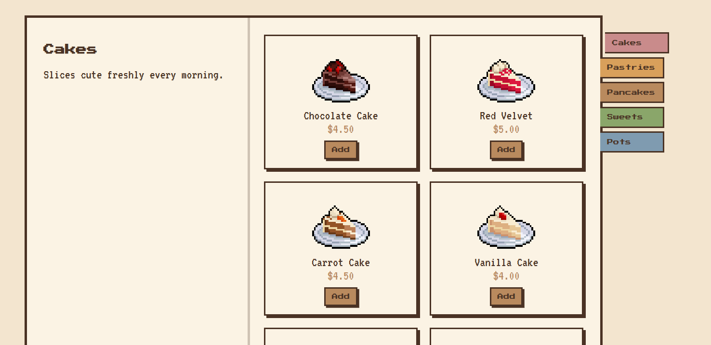
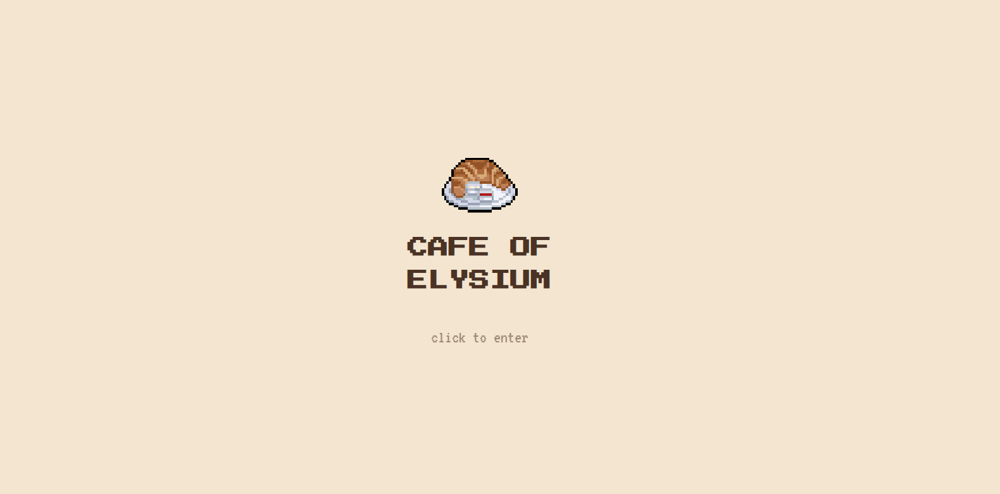
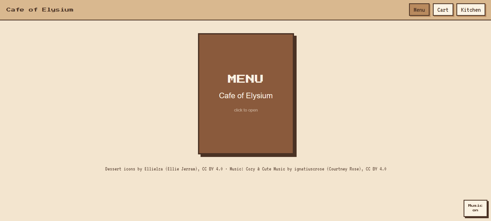
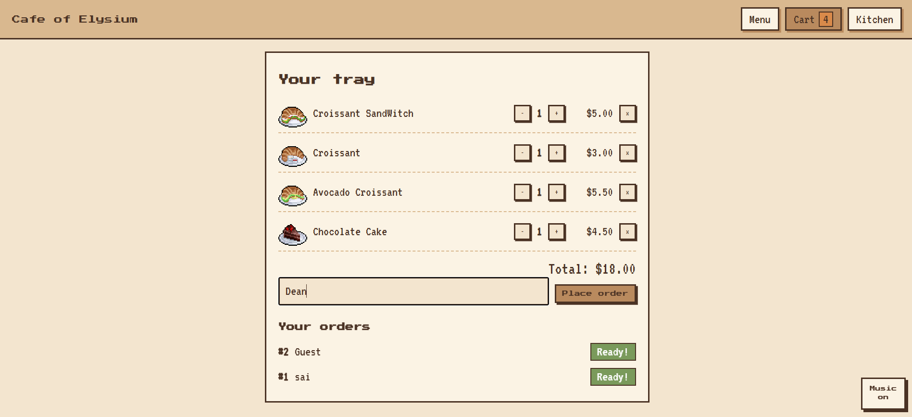
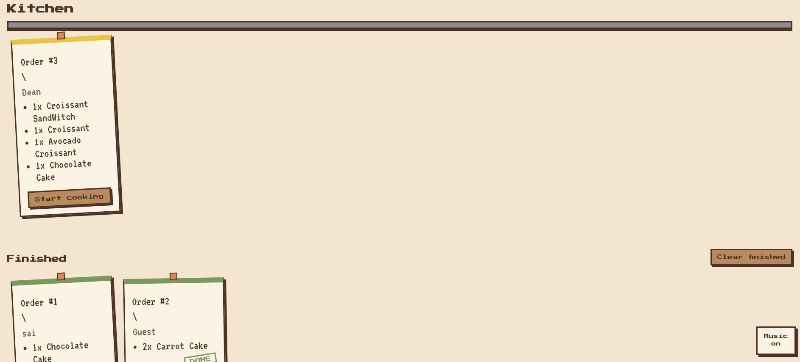

## Cafe of Elysium

A cozy pixel-art cafe ordering system. Browse the menu book, fill up your tray, send the order, and watch it show up on the kitchen's ticket rail.

[**Live Demo**](https://cafe-of-elysium.vercel.app/)



## Why I made this
This was my project for the Pixl Order up Quest, and I wanted it to feel like its a cozy tiny cafe you'd actually want to sit in, not a boring order form.

## How it works

**1. Click to enter.**
Right after opening the website we see a nice Splash screen and right when u click the screen the music starts!



**2. The menu book.**
I wanted to make the menu look more cozy and elegant thats why i made it into a book, it has bookmarks as the 7 tabs and the total items are 81(61 desserts and 20 drinks).
Also added Today’s Special, the box on the left page that changes every day.



**3. Your tray.** 
The Cart section has your tray and everything, we can add/subtract any item and see the total amount, we can also write our name for our order.
A "Your orders" list which shows its live status("Order received", "Cooking...", "Ready!")



**4. Kitchen.**
The kitchen page is where orders show up as paper tickets hanging from a rail, each with a pin.
in the ticket we see order list, Name and at start new tickets have yellow top and says start cooking.
Also added more stats boxes (total orders, most ordered item, earned) and the waiting timers (orange after 2 minutes, red after 5)
After “Mark done”, it moves down to the Finished section with a green top and a DONE stamp.



## Try the full flow 
1. Open the site and place an order from the cart page.
2. Open the Kitchen section in a **second tab of the same browser**.
3. Click "start cooking", then "Mark done".
4. switch back to the first tab. The status updates by itself.

The orders are saved in the localStorage, so the sync works between tabs in one browser, not between different devices. since this was a bonus i choose to do it this way.

## Other stuffs that i added

- A 4-song playlist that fades in, with a mute button that remembers your choice
- Ding sounds when an order is placed and when a ticket is done!
- The cart is saved, so a refresh doesn't empty your tray.
- It works on phones: the book collapses to one page and the tabs move to the top.

## What I'd add next
- A real backend so orders work across devices

  ## Built with
  - React + vite
  - React Router(Hash)
  - React Context for the shared cart and orders
  - Plain CSS with a matte light brown palette, Press Start 2P and VT323 fonts
 
## Run it locally

```
git clone https://github.com/shiz1ee/Cafe-of-Elysium.git
cd Cafe-of-Elysium
npm install
npm run dev
```

## Credits 
- Dessert icons by [Ellielza (Ellie Jerram)](https://luminleveret.itch.io/desserts), Licensed under CC BY 4.0
- Drinks icons by [Omnia](https://wish1.itch.io/wishdrinkspack)
- Music: "Cozy & Cute Music" by [ignatiuscrose (Courtney Rose)](https://ignatiuscrose.itch.io/cozy-cute-music-1), CC BY 4.0
